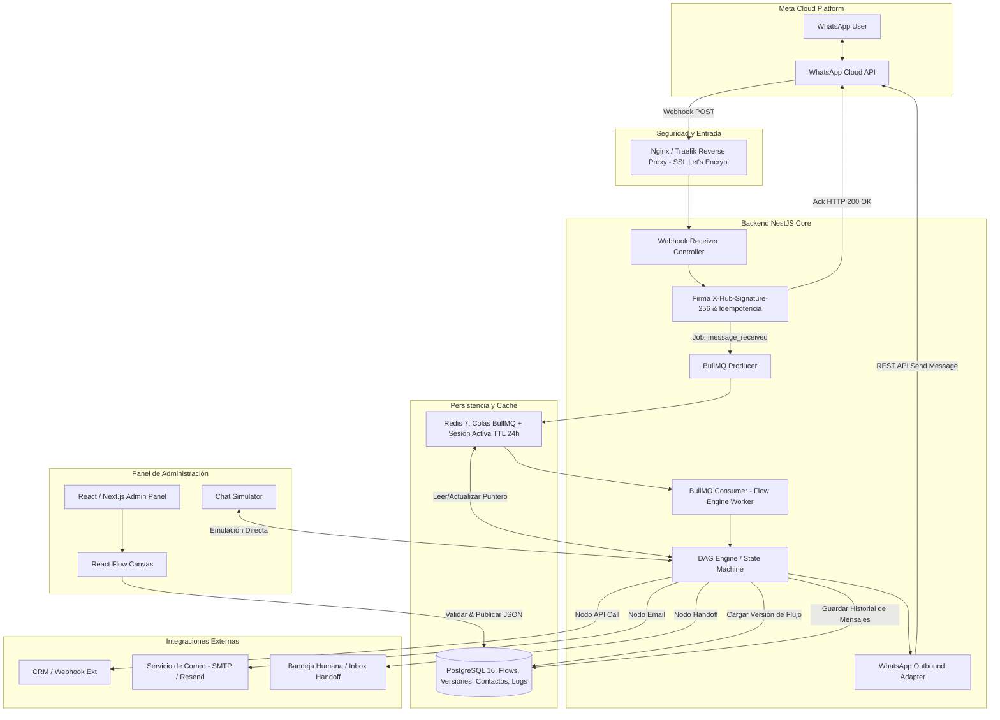

# Análisis de Factibilidad Técnica y Plan de Implementación
## Plataforma de Chatbot para WhatsApp con Editor Visual No-Code

---

## 1. Resumen Ejecutivo y Alcance del Proyecto

El objetivo es desarrollar una **plataforma propia e independiente (propiedad intelectual total)** de automatización de WhatsApp basada en un **editor visual de flujos ("No-Code")** y un **motor de ejecución conversacional determinístico**, conectada a la API oficial **WhatsApp Cloud API de Meta**.

- **Volumen inicial proyectado:** 100 a 1.000 conversaciones diarias (fácilmente escalable a decenas de miles).
- **Modelo de Tenencia:** **Multi-Tenant Nativo**, aislamiento estricto por `tenant_id` en todas las entidades, soporte para múltiples organizaciones, múltiples números WABA por organización, contactos aislados y sesiones concurrentes.
- **Enfoque clave:** Separación estricta entre el **Motor de Ejecución (Flow Engine)** y el **Panel de Administración (Visual Studio / React Flow)**, garantizando despliegues sin interrupción de servicio, inmutabilidad de flujos en producción y soberanía total sobre los datos.
- **Estado de Avance:** **Fases 1, 2, 3, 4 y 5 OPERATIVAS Y VALIDADAS:**
  - *Fase 1:* Infraestructura Docker (PostgreSQL 16, Redis 7), Webhooks Meta con firma SHA-256 y cola BullMQ.
  - *Fase 2:* Motor DAG determinístico, máquina de estados, variables, vCards y sesiones con TTL 24h.
  - *Fase 3:* Panel No-Code con React Flow, Inspector, Paleta de nodos, Linter de grafos y Simulador de WhatsApp.
  - *Fase 4:* Nodos avanzados (API Call, Capturas tipadas, Condicionales IF/ELSE y bifurcaciones).
  - *Fase 5:* Bandeja de Atención Humana (Inbox Handoff), silenciamiento del bot, toma de control en vivo, respuestas de operadores y control de ventana de 24 horas de Meta.

---

## 2. Síntesis Comparativa y Complementos de Valor entre Documentos

El análisis compara el documento base (**Doc 1**: *Arquitectura recomendada chatbot WhatsApp*) con la propuesta alternativa (**Doc 2**: *Propuesta de Arquitectura WhatsApp Bot*), integrando lo mejor de ambos:

| Dimensión | Documento Base (Doc 1) | Propuesta Alternativa (Doc 2) | Integración / Decisión Arquitectónica Óptima |
| :--- | :--- | :--- | :--- |
| **Backend Framework** | NestJS + TypeScript | NestJS o Fastify + TypeScript | **NestJS (TypeScript)**: Mayor modularidad, inyección de dependencias, soporte de microservicios e integración nativa con `@nestjs/bullmq`. |
| **Persistencia del Flujo** | PostgreSQL relacional (tablas `flow_nodes`, `flow_edges` y JSON de versión) con Prisma ORM | PostgreSQL con columna `published_json` (JSONB consolidado) | **Híbrido Optimizado**: Guardar el grafo publicado en `JSONB` para lectura ultrarrápida del motor (sub-milisegundo) y almacenar metadatos/versiones en tablas relacionales con Prisma. |
| **Gestión de Sesión** | PostgreSQL como almacén de estado y variables | Redis con TTL (24 horas) para sesión activa en caliente | **Redis + PostgreSQL (Write-Through/Async Sync)**: Redis mantiene el puntero del nodo (`current_node_id`) y variables activas en memoria (< 5 ms de latencia); PostgreSQL persiste el histórico completo, mensajes y auditoría. |
| **Nodos Especializados** | Menú, Mensaje, Captura, Condición, WhatsApp Flow, Acción, Derivación, Fin | Agrega explícitamente: **API Call** (integración externa en tiempo real) e inputs tipados | **Adopción de Nodo `API Call`**: Imprescindible para consultar bases externas (pólizas, saldos, autenticaciones) e inyectar el resultado en las variables del flujo. |
| **Handoff / Derivación** | Email, enlace wa.me, bandeja humana | Agrega **vCard nativa de WhatsApp** (`contacts`), Email con plantilla y silenciado de bot en bandeja | **Soporte Triple de Derivación**: 1) Enviar vCard nativa (contacto directo del asesor), 2) Notificación Email / Webhook a CRM, 3) Cambio de estado a `handed_off` con silenciado del bot para atención humana en vivo. |
| **Validación & Simulación** | Detección de nodos huérfanos, validación de esquemas | Simulador de chat interactivo en el panel lateral (Canvas) | **Simulador de flujo en el frontend**: Permite al usuario de negocio probar el flujo en tiempo real emulando mensajes de WhatsApp antes de publicar la versión. |
| **Evolución Futura IA** | Determinístico primero, LLM posterior | Sugiere microservicio Python / pgvector para RAG documental | **Arquitectura RAG-Ready**: El motor determinístico opera en Node.js; se deja preparado el nodo tipo `AI Agent` o `RAG Query` hacia un microservicio auxiliar. |

---

## 3. Análisis de Factibilidad Técnica

### 3.1 Viabilidad del Stack Tecnológico
- **WhatsApp Cloud API:** 100% factible. Ofrece hasta 80 mensajes por segundo (MPS) en niveles básicos, superando ampliamente el requerimiento de 1.000 conversaciones/día (~0.05 a 0.5 MPS en promedio).
- **NestJS + TypeScript:** Excelente arquitectura basada en módulos (`WebhookModule`, `QueueModule`, `EngineModule`, `FlowsModule`, `ContactsModule`).
- **Redis + BullMQ:** Garantiza el procesamiento desacoplado de webhooks. Meta exige responder `HTTP 200 OK` en menos de 3 a 5 segundos; BullMQ permite responder en < 150 ms y encolar el trabajo pesado.
- **React + React Flow (@xyflow/react):** Es la biblioteca estándar de la industria para canvas basados en grafos. Permite crear nodos personalizados para botones, listas interactivas, capturas y derivaciones.
- **PostgreSQL + Prisma ORM:** PostgreSQL maneja con solvencia millones de filas de `messages_log` y permite indexar campos JSONB mediante GIN si se requiere buscar datos específicos.

### 3.2 Restricciones de Meta y Factibilidad Operativa
1. **Ventana de Atención de 24 Horas:** Meta no permite enviar mensajes de sesión gratuitos pasadas las 24 horas del último mensaje del usuario. La arquitectura maneja esto con un TTL en Redis y el uso condicional de plantillas aprobadas (*Message Templates*) si se requiere reactivar la conversación.
2. **Límites de UI de WhatsApp:**
   - **Botones Interactivos:** Máximo 3 botones por mensaje.
   - **Mensajes de Lista:** Hasta 10 opciones agrupadas en secciones.
   - **WhatsApp Flows (Formularios Nativos):** Requiere configuración de endpoint de datos (Data Exchange Endpoint) si se desea validar datos dinámicamente.
   - *Mitigación:* El editor en React Flow debe validar en el cliente que ningún nodo exceda estos límites antes de permitir la publicación.
3. **Idempotencia y Duplicados:** Meta reintenta enviar webhooks si la red fluctúa. Se implementa una verificación atómica de `wamid` (WhatsApp Message ID) en Redis con expiración de 48 horas (`SET key NX EX 172800`). Si el `wamid` ya existe, se descarta inmediatamente.
4. **Control de Concurrencia y FIFO:** Si un usuario envía múltiples mensajes rápidos, deben procesarse en orden estricto. Con BullMQ se implementa una cola con clave de agrupación (`jobId: contact_phone` o colas secuenciales por usuario) para evitar condiciones de carrera.

### 3.3 Requisitos de Infraestructura y Costos
- **VPS Inicial:** 2 a 4 vCPU, 4 a 8 GB RAM (Ubuntu 22.04 LTS). Costo estimado: $15 - $40 USD/mes.
- **Carga esperada:** 1.000 conversaciones diarias representan aproximadamente 10.000 a 20.000 mensajes al día. Con Redis y optimización de consultas, el uso de CPU promedio será inferior al 15%.
- **Almacenamiento:** ~15 MB de registros de mensajes diarios; copias de seguridad incrementales en PostgreSQL.

---

## 4. Arquitectura del Sistema

---

## 5. Diseño Detallado del Modelo de Datos (PostgreSQL + Prisma)

### 5.1 Tablas Principales
1. **`users`**: Administradores y diseñadores del panel (autenticación JWT, roles `ADMIN`, `BUILDER`, `OPERATOR`).
2. **`whatsapp_accounts`**: Configuración de WABA (`phone_number_id`, `waba_id`, tokens encriptados AES-256).
3. **`flows`**: Flujos creados (`id`, `name`, `description`, `is_active`, `created_at`).
4. **`flow_versions`**: Versiones inmutables (`id`, `flow_id`, `version_number`, `status: DRAFT | PUBLISHED | ARCHIVED`, `definition: JSONB`, `changelog`).
5. **`contacts`**: Clientes (`id`, `phone_number`, `first_name`, `metadata: JSONB`).
6. **`conversations` / `sessions`**: Sesiones de chat (`id`, `contact_id`, `flow_version_id`, `current_node_id`, `status: BOT_ACTIVE | HANDED_OFF | CLOSED`, `variables: JSONB`, `last_activity_at`).
7. **`messages`**: Registro cronológico (`id`, `conversation_id`, `wamid`, `sender: USER | BOT | AGENT`, `type: TEXT | INTERACTIVE | FLOW | VCARD`, `content: JSONB`, `status: SENT | DELIVERED | READ | FAILED`).
8. **`audit_logs`**: Trazabilidad de quién publicó o modificó flujos y reglas.

---

## 6. Plan de Implementación por Fases y Entregables

### Fase 1: Cimientos de Infraestructura, Seguridad y Webhook de Meta
**Objetivo:** Establecer el canal oficial de comunicación bidireccional estable y tolerante a fallos.
- **Tareas:**
  - Configurar App en Meta Developer Portal y WABA de pruebas.
  - Inicializar monorepo/backend con NestJS, TypeScript, Docker y Prisma.
  - Implementar endpoint `GET /webhook` (verificación de token de Meta).
  - Implementar endpoint `POST /webhook` con validación criptográfica de firma `X-Hub-Signature-256`.
  - Configurar Redis y BullMQ: desacoplar la recepción para responder HTTP 200 en < 100 ms.
  - Implementar filtro de deduplicación de mensajes basado en `wamid`.
- **Entregable:** Servidor desplegado que recibe mensajes de WhatsApp, los valida, encola y responde un eco básico de prueba.

### Fase 2: Motor de Ejecución de Flujos (DAG Engine) y Gestión de Estado
**Objetivo:** Desarrollar el núcleo que interpreta grafos de decisión sin depender de la UI.
- **Tareas:**
  - Definir la especificación del esquema JSON de flujos (nodos, aristas/edges, condiciones).
  - Diseñar el evaluador de transiciones: resolución de selección (botones, listas, texto libre, regex).
  - Implementar el gestor de sesiones en caliente en Redis con TTL de 24 horas y sincronización a PostgreSQL.
  - Desarrollar la persistencia de variables acumuladas (`collected_data`: nombre, cédula, póliza, etc.).
  - Implementar comandos globales de escape: "menú principal", "reiniciar", "asesor humano".
- **Entregable:** Motor de ejecución capaz de procesar un archivo JSON complejo y sostener una conversación contextual multicamino vía WhatsApp.

### Fase 3: Editor Visual de Flujos (Frontend con React Flow)
**Objetivo:** Panel de administración intuitivo No-Code para diseñar y publicar flujos.
- **Tareas:**
  - Crear proyecto React / Next.js con Tailwind CSS y componentes modulares.
  - Integrar `@xyflow/react` con lienzo interactivo (zoom, minimapa, arrastrar y soltar).
  - Crear catálogo de nodos personalizados:
    - *Nodo Inicio (Trigger)*
    - *Nodo Mensaje (Texto con variables {{variable}})*
    - *Nodo Botones Interactivos (hasta 3 opciones)*
    - *Nodo Lista Desplegable (hasta 10 opciones)*
    - *Nodo Captura de Datos (con validador de tipo: email, número, texto)*
    - *Nodo Condicional (IF / ELSE basado en operadores lógicos)*
    - *Nodo Fin*
  - Diseñar panel lateral (Sidebar Inspector) para configurar propiedades del nodo activo.
  - Implementar validación estricta de grafos (Linter de flujo: detectar nodos sin conexión, ciclos infinitos o salidas huérfanas).
  - Sistema de versionado: guardar Borrador (*Draft*) y Publicar (*Publish* inmutable).
- **Entregable:** Panel web donde un usuario diseña un flujo completo y al pulsar "Publicar", el bot actualiza su comportamiento en vivo.

### Fase 4: Nodos Avanzados (API Call, WhatsApp Flows, vCard) y Simulador
**Objetivo:** Integrar el bot con sistemas externos y potenciar la experiencia interactiva.
- **Tareas:**
  - **Nodo API Call:** Ejecutar peticiones HTTP `GET`/`POST` parametrizadas con variables del flujo, mapear la respuesta JSON y almacenar valores en variables de sesión.
  - **Nodo Derivación vCard:** Generar mensaje estructurado tipo `contacts` para que el usuario guarde el contacto del asesor con un toque.
  - **Soporte para WhatsApp Flows Oficial:** Disparar pantallas de formularios nativos de Meta y capturar el payload retornado.
  - **Simulador Web Lateral:** Chat interactivo en el panel que permite probar el flujo navegando por los nodos en tiempo real sin gastar mensajes de WhatsApp.
- **Entregable:** Flujos capaces de consultar bases de datos externas en tiempo real y simulador funcional para pruebas previas.

### Fase 5: Handoff Humano y Sistema de Derivación Multicanal
**Objetivo:** Gestión fluida de escalamiento a operadores humanos y notificaciones.
- **Tareas:**
  - Módulo de envío de correos transaccionales (SMTP / Resend) con resumen de la sesión.
  - Bandeja básica de atención humana (Inbox):
    - Detección de estado `HANDED_OFF`.
    - Silenciado del bot automático para el contacto.
    - Interfaz web para que el operador envíe y reciba mensajes directos.
    - Botón de "Finalizar atención" que reasigna el contacto al bot.
  - Control de ventana de 24 horas y alertas si la ventana está por expirar.
- **Entregable:** Sistema híbrido Bot-Humano plenamente coordinado.

### Fase 6: Pruebas de Carga, Observabilidad, Seguridad y Despliegue
**Objetivo:** Puesta en producción robusta y monitoreada.
- **Tareas:**
  - Pruebas de concurrencia y ráfagas (Artillery / k6) simulando 500 webhooks concurrentes.
  - Observabilidad: configuración de logs estructurados (Winston/Pino), métricas y alertas de error en cola.
  - Endurecimiento de seguridad: rate limiting en Nginx, variables de entorno protegidas, encriptación de tokens WABA.
  - Configuración de backups automáticos de PostgreSQL.
- **Entregable:** Plataforma en producción, con documentación operativa y manual de usuario.

---

## 7. Matriz de Riesgos Técnicos y Mitigaciones

| Riesgo Técnico | Severidad | Probabilidad | Estrategia de Mitigación |
| :--- | :---: | :---: | :--- |
| **Pérdida de mensajes o bloqueos por latencia de Meta** | Alta | Media | Responder HTTP 200 de inmediato y delegar la ejecución a BullMQ con reintentos exponenciales. |
| **Respuestas duplicadas (Loop de Webhooks)** | Crítica | Alta | Registro atómico de `wamid` en Redis (`SET NX EX`) antes de procesar cualquier evento. |
| **Publicación de flujos con errores que rompan chats activos** | Alta | Media | Versionado inmutable: las conversaciones activas terminan en la versión con la que iniciaron; la nueva versión solo aplica a nuevas sesiones. |
| **Bloqueo por expiración de ventana de 24 horas** | Media | Alta | Monitoreo del timestamp del último mensaje de usuario; bloqueo de envíos libres y notificación para usar plantillas autorizadas. |
| **Fallas en APIs externas (Nodo API Call lento o caído)** | Alta | Media | Configuración de timeouts estrictos (máx. 3.000 ms) y salida de contingencia (*Fallback Edge*) en el nodo API. |

---

## 8. Recomendación Estratégica Inmediata

1. **Aislamiento Multitenant desde el Inicio:** Aunque el bot comience para una sola empresa (ej. empresa de seguros), es altamente recomendable diseñar el modelo de datos con una clave `organization_id` o `account_id` en las tablas clave (`flows`, `whatsapp_accounts`, `contacts`). Esto no agrega costo técnico relevante hoy y evitará una reescritura masiva si mañana se decide comercializar la plataforma como SaaS.
2. **Definir el Catálogo Inicial de Nodos MVP:** Comenzar con los 6 nodos fundamentales: *Inicio*, *Mensaje*, *Opciones/Botones*, *Captura de Datos*, *API Call* y *Derivación (vCard/Email)*.
